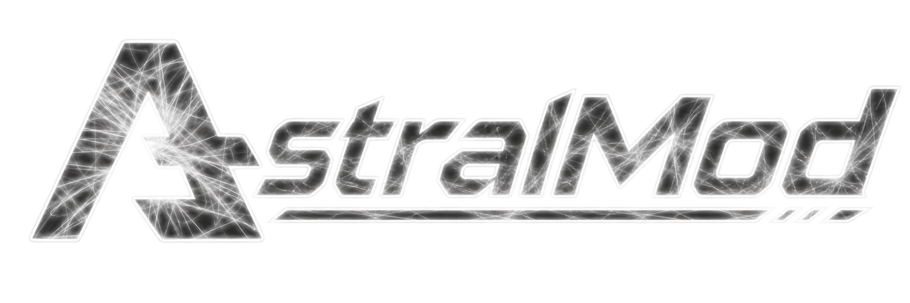

# AstralMod Team Fortress 2
  
Way too much in one place obviously, this is pasted on top of pasted  
Use it how you wish, This will continue to be maintained just open source now  

Yes this is beyond pasted, alot of it's features are ports from other cheats  

Build it with Clang-cl (Get it from Visual Studio LLVM Packages)  
A build script has been provided for your use  
It will make both AVX2 and SSE DLLs inside a "Dist" folder  

Crashed? Open an Issue  

Discord? No, not after what happened to the first one  

AstralMod follows a Bleeding Edge workflow, Expect bugs and issues  
Feel free to report them in the Issues  

# External Dependencies  
Yea we know stupid, We utilized [Nihon's Music Framework](https://github.com/com/XeraFang-Solutions/Music-Framework) for its NoCRT library and headers  
This is what lets us display music from the windows media session directly without CRT  
Just put it in `externals/Music-Framework` and Astral will compile  

# Loader
Our loader is built using regular `MSBUILD`, It sends information to the cheat for your `Username`  
The loader can also load any DLLs in the same folder as itself, So have fun with it  
Our loader has support for themida out of the box, It is based on the Framework Unified Loader  
Release x64 will compile without Themida for the very reason that we cannot safely bundle the ThemidaSDK  
If you have your own copy of Themida you can use Secure x64 after placing the SDK in the following place  
`FUL Astral/FUL/vendor/ThemidaSDK` Themida will know what to do when you load the binary into it  
**YES WE KNOW IT TAKES TIME TO INJECT, ITS BECAUSE WE HIJACK THREADS FOR MANUALMAPPING**  

# Website
The website will never be open source, It's not important enough to care about  

# Playerlist/Database
We use Lunaris' public database and our own database for player marks  

# Credits  
The Atlas Developers - The Base Cheat Itself  
SEOwned by [Spook953](https://github.com/spook953) as it was the first cheat I ever got to toy with the source of  
[FedoraWare's](https://github.com/Fedoraware/Fedoraware) [Legacy](https://github.com/Fedoraware/Fedoraloader-Legacy) and [Final](https://github.com/Fedoraware/Fedoraloader) Loaders, for their injection was the true original base  
[Amalgam](https://github.com/rei-2/Amalgam) - Several features ported including different aimtypes  
[Unibox](https://github.com/GatoPotato658/Unibox) - Ported the Telemetry Blocker from them  
> Wow I actually found something useful in there  

HackVSHack.net - Many sources we pulled from for our project including the [Original Loader Source](https://hackvshack.net/threads/astral-loader-wannabe-framework.13357/)  
[Botox](https://github.com/gumballpanties-sudo/botox-tf2) for the Movement Lab  
[kdt255](https://github.com/kdt255/Astral-Remake) as their Astral Menu is what inspired the NextGen GUI
[Daniel Krupinski](https://github.com/danielkrupinski/vac-bypass) for their amazing Vac Bypass as a base for our VACSAFE Module
[Guided Hacking](https://github.com/guidedhacking/GuidedHacking-Injector) for both their Injector to learn from and their forums with guidance to make this real  
[Ateris Technologies](https://github.com/eternal-blu/ateris-technologies) for being one of the first cheats I ever learned from and worked on  
[RijiN (RileyKun's fork)](https://github.com/RileyKun/RijiN) for an excellent source of knowledge and helpful learning NoCRT  
And finally, Those who gave recommendations, feedback, and have helped with testing as without you this wouldn't be here
